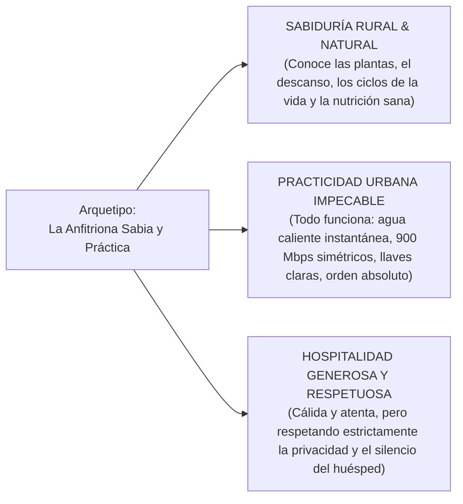

# 🌿 Manifiesto de Marca, Tono de Voz & Identidad Verbal
**Ecosistema:** Casa Normandía (Bogotá) & Granja Educativa (Nilo)  
**Módulo:** `02_marketing_comunicaciones_y_fidelizacion/2.1_estrategia_y_marca`  
**Versión:** 1.0 — Octubre 2026  
**Propósito:** Definir el alma, la narrativa fundacional y las directrices verbales de comunicación para anfitriones, creadores de contenido y canales directos.

---

## 📑 Tabla de Contenidos Clickeable

1. [El Manifiesto de Marca: Del Asfalto a la Tierra Fértil](#1--el-manifiesto-de-marca-del-asfalto-a-la-tierra-fértil)
2. [El Moodboard Conceptual (Universo Visual)](#2--el-moodboard-conceptual-universo-visual)
3. [Arquetipo de Marca: «La Anfitriona Sabia y Práctica»](#3--arquetipo-de-marca-la-anfitriona-sabia-y-práctica)
4. [Los Cuatro Pilares del Tono de Voz](#4--los-cuatro-pilares-del-tono-de-voz)
5. [Diccionario Terminológico & Filtros de Calidad](#5--diccionario-terminológico--filtros-de-calidad)
6. [Guía de Aplicación Práctica: Copys & Plantillas Reales](#6--guía-de-aplicación-práctica-copys--plantillas-reales)
   - [Mensaje de Bienvenida Directo (WhatsApp)](#ejemplo-1-bienvenida-de-reserva-directa-por-whatsapp)
   - [Respuesta a Solicitudes Especiales (Silla Ergonómica / Parqueadero)](#ejemplo-2-solicitud-de-silla-ergonómica-stock-limitado)
   - [Invitación Cross-Over: De Bogotá a Nilo](#ejemplo-3-invitación-del-asfalto-al-campo-bogotá--nilo)
   - [Publicación Editorial para Redes (LinkedIn / Instagram)](#ejemplo-4-post-editorial-para-redes)

---

## 1. 📜 El Manifiesto de Marca: Del Asfalto a la Tierra Fértil

> ### *Vivimos en un mundo que confunde la prisa con el progreso y el ruido con la vida.*
>
> *Creemos que el verdadero lujo contemporáneo no es el mármol frío ni las promesas vacías de un hotel impersonal. El verdadero lujo es el **silencio**, la **buena luz**, el **arraigo** y la certeza de llegar a un lugar donde las cosas funcionan con serenidad.*
>
> *En **Casa Normandía**, rescatamos la calidez arquitectónica de una casa bogotana de los años 70 para convertirla en un refugio independiente, sobrio y productivo. Un espacio donde la fibra óptica de 900 Mbps convive con el crujido noble de la madera, donde se descansa con silencio acústico a minutos del aeropuerto y de las grandes avenidas.*
>
> *Y cuando la ciudad satura la mente, miramos hacia nuestras raíces en **Nilo**: una tierra fértil donde la medicina botánica, los árboles frutales y las gallinas libres nos recuerdan que la vida tiene un ritmo natural, generoso y honesto.*
>
> *No somos un hotel en serie. No somos un alojamiento de paso improvisado.  
> **Somos un ecosistema de hospitalidad arraigada, acogedora y consciente.**  
> Bienvenidos a su casa.*

---

## 2. 🎨 El Moodboard Conceptual (Universo Visual)

El universo estético del ecosistema fusiona la **herencia campestre colombiana** (el Jeep Willys verde clásico, canastos de mimbre y huertas orgánicas) con la **sofisticación mid-century urbana de Bogotá** (madera maciza, plantas de interior, luz dorada y tonos terracota).

### Paleta Cromática Aplicada
* **Verde Raíz (`#1B4332`):** La vegetación nativa, el follaje de la granja y la solidez institucional.
* **Terracota Cálido (`#C86D51`):** La arcilla cocida, la tierra fértil de Nilo, la calidez del hogar bogotano.
* **Crema Suave (`#F9F6F0`):** La luz filtrada por las cortinas, el lino limpio, el descanso visual.
* **Dorado Acento (`#D4A373`):** El detalle artesanal, el acento noble botánico y la excelencia en el servicio.

---

## 3. 👵🏼 Arquetipo de Marca: «La Anfitriona Sabia y Práctica»

Nuestra personalidad no es la de un conserje acartonado de hotel 5 estrellas ni la de un robot automatizado. Nuestro arquetipo es la **Anfitriona Sabia y Práctica** (inspirada en la figura que sabe cuidar, sembrar y organizar con maestría):

### Rasgos de Personalidad
1. **Maternalmente eficiente:** Te hace sentir en casa desde el primer minuto, pero sin rodeos ni trámites burocráticos.
2. **Con los pies en la tierra:** No usa tecnicismos rimbombantes ni palabras de moda (*buzzwords*). Habla con sencillez, verdad y precisión.
3. **Generosa en los detalles:** Una taza de café bien servida, un jabón botánico artesanal, un estudio ventilado y sábanas de tacto impecable.

---

## 4. ⚖️ Los Cuatro Pilares del Tono de Voz

| Pilar | Cómo se manifiesta | Lo que NUNCA decimos |
| :--- | :--- | :--- |
| **1. Serena & Hospitalaria** | Escribimos como quien recibe a un invitado de honor en su propia casa: con afecto, calma y respeto. | No usamos frialdad corporativa (*"Estimado usuario, su solicitud ha sido radicada"*). |
| **2. Práctica & Resolutiva** | Respuestas directas, instrucciones numéricas claras, pasos sencillos y soluciones inmediatas. | No damos vueltas ni dejamos dudas operativas en el aire. |
| **3. Honesta & Verídica** | Describimos cada estudio tal como es: metrajes reales, dotación exacta de cocinas y reglas transparentes. | Jamás exageramos (*"Suite ultra-lujo con jacuzzi"* cuando es una bañera clásica). |
| **4. Consciente & Arraigada** | Conectamos el descanso urbano con el valor de la naturaleza, el producto local y el bienestar. | No tratamos el hospedaje como una simple transacción de metros cuadrados. |

---

## 5. 🚫 Diccionario Terminológico & Filtros de Calidad

> [!IMPORTANT]
> **Regla de Oro:** Todo texto que salga a la web, WhatsApp, folletos o redes debe pasar por este filtro:

* ❌ **PROHIBIDO: "Coliving"**  
  👉 **USAR SIEMPRE:** *«Hospitalidad Urbana & Apartamentos/Estudios Independientes»*.
* ❌ **PROHIBIDO: "Cocineta"**  
  👉 **USAR SIEMPRE:** *«Cocina compacta funcional»* o *«Cocina integral completa»*.
* ❌ **PROHIBIDO: "Tina con hidromasaje / Jacuzzi"**  
  👉 **USAR SIEMPRE:** *«Tina tradicional profunda»* o *«Bañera clásica de relajación»*.
* ❌ **PROHIBIDO: "Sin TV"**  
  👉 **USAR SIEMPRE:** *«Smart TV / Roku»* (Todos los estudios tienen televisión con streaming).
* ❌ **PROHIBIDO: Nombres familiares en público** `(ASS)`, `(ESVV)`, `(Natalia)`, `(Adriana)`  
  👉 **USAR SIEMPRE:** Referencias de servicio profesional (*"Nuestro equipo de anfitriones"*, *"Recepción y concierge"*).

---

## 6. ✍️ Guía de Aplicación Práctica: Copys & Plantillas Reales

### Ejemplo 1: Bienvenida de Reserva Directa por WhatsApp
> *"¡Hola, [Nombre]! Qué alegría saludarte. Te damos una muy cálida bienvenida a Casa Normandía.  
> Confirmamos tu reserva en **[Nombre del Estudio, ej: The Garden Suite 201]** para las fechas del **[Fecha Llegada]** al **[Fecha Salida]**.  
>  
> Tu estudio cuenta con cocina propia completamente equipada, Smart TV y conexión de fibra óptica dedicada de 900 Mbps para que trabajes o descanses con total fluidez.  
>  
> En este enlace tienes tu **Guía Digital del Huésped**: [concierge.html](https://casanormandia.co/concierge.html) con la clave del Wi-Fi, indicaciones de llegada y recomendaciones del barrio.  
> Cualquier detalle que necesites para tu estancia, aquí estamos atentos para que te sientas como en casa."*

---

### Ejemplo 2: Solicitud de Silla Ergonómica (Stock Limitado a 2 Unidades)
> *"¡Con mucho gusto, [Nombre]! Contamos con 2 sillas ergonómicas de alto confort en la casa para apoyar jornadas intensas de trabajo.  
> Con gusto te la asignamos a tu estudio durante tu estancia para que trabajes con la mayor comodidad. Ya queda coordinado con nuestro equipo."*

*(En caso de que ambas estén en uso):*  
> *"Hola, [Nombre]. En este momento nuestras 2 sillas ergonómicas especiales se encuentran asignadas a otros huéspedes. Sin embargo, tu estudio cuenta con su escritorio y silla de trabajo confortable lista para ti. Si se desocupa una de las sillas ergonómicas antes de que termine tu estancia, te avisaremos de inmediato con prioridad."*

---

### Ejemplo 3: Invitación del Asfalto al Campo (Bogotá ⇄ Nilo)
> *"¿Sabías que Casa Normandía tiene raíces en el campo?  
> A dos horas de Bogotá, en el clima cálido de Nilo (Cundinamarca), cultivamos nuestra granja regenerativa: medicina botánica, árboles frutales y gallinas de pastoreo libre.  
> Si durante tu estancia en Bogotá deseas desconectarte un fin de semana entre la naturaleza viva, avísanos con gusto para prepararte una experiencia a tu medida."*

---

### Ejemplo 4: Post Editorial para Redes (LinkedIn / Instagram)
> **Titular:** *El silencio también es productividad.*  
>  
> *Hay días en que la ciudad exige demasiado ruido. Para quienes viajan por proyectos estratégicos, consultoría o trabajo remoto, encontrar un espacio en Bogotá que combine silencio acústico real, luz natural y 900 Mbps de internet simétrico no es un capricho: es una necesidad operativa.*  
>  
> *En Casa Normandía remodelamos una casa de los 70 conservando su alma y dotándola de independencia total. Apartamentos y estudios privados a 15 minutos del aeropuerto El Dorado, pensados para vivir y trabajar bien.*  
>  
> *Y cuando hace falta respirar tierra fértil, nuestra granja en Nilo nos recuerda de dónde venimos.*  
>  
> 📍 *Normandía, Bogotá D.C. | Reserva directa sin intermediarios.*
