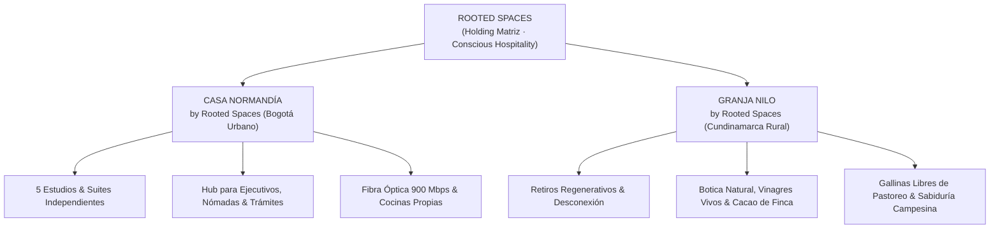
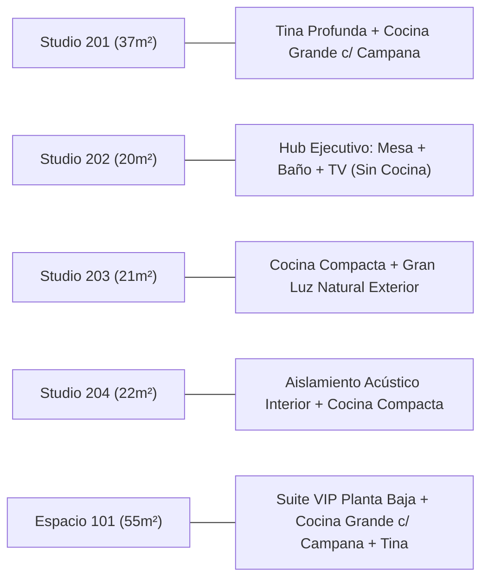
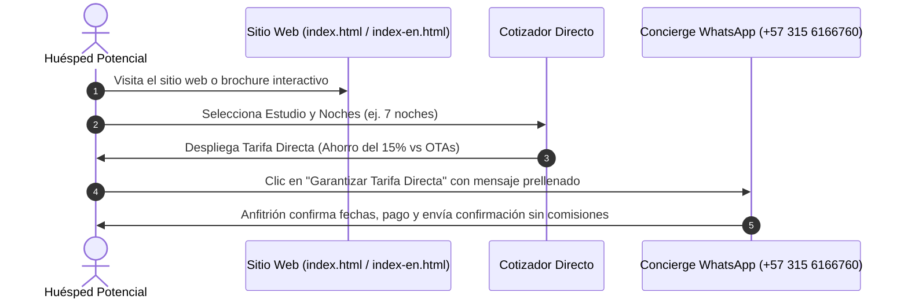

# 🌿 Manual Maestro de Marca & Estrategia — ROOTED SPACES
**Holding Matriz:** ROOTED SPACES · Conscious Hospitality  
**Propiedades Endosadas:** Casa Normandía (Bogotá Urbano) & Granja Nilo (Cundinamarca Rural)  
**Módulo:** `02_marketing_comunicaciones_y_fidelizacion/2.1_estrategia_y_marca`  
**Versión:** 3.0 (Definitiva — Sistema Masterbrand Unificado)  
**Fuente Única de Verdad de Activos:** [`07_assets/`](file:///c:/Development/casa-normandia-ops/07_assets/)

---

## 📑 Tabla de Contenidos Clickeable

1. [Visión General, Manifiesto & Arquitectura Endosada](#1--visión-general-manifiesto--arquitectura-endosada)
2. [Propuesta de Valor & Posicionamiento de Marca](#2--propuesta-de-valor--posicionamiento-de-marca)
3. [Sistema de Logotipos & Activos Oficiales (`07_assets`)](#3--sistema-de-logotipos--activos-oficiales-07_assets)
4. [Normas de Protección del Logo, Proporciones & Usos Incorrectos](#4--normas-de-protección-del-logo-proporciones--usos-incorrectos)
5. [Paleta Cromática & Códigos Oficiales](#5--paleta-cromática--códigos-oficiales)
6. [Tipografía & Jerarquía Visual](#6--tipografía--jerarquía-visual)
7. [Voz de Marca & Diccionario Terminológico Obligatorio](#7--voz-de-marca--diccionario-terminológico-obligatorio)
8. [Arquitectura de Producto & Verdad Operativa](#8--arquitectura-de-producto--verdad-operativa)
9. [Pilares de Servicio & Protocolos de Huéspedes](#9--pilares-de-servicio--protocolos-de-huéspedes)
10. [Embudo Comercial & Estrategia Directa (Direct-to-Guest)](#10--embudo-comercial--estrategia-directa-direct-to-guest)
11. [Checklist de Aplicación para Creadores & Diseñadores](#11--checklist-de-aplicación-para-creadores--diseñadores)

---

## 1. 🌐 Visión General, Manifiesto & Arquitectura Endosada

Rooted Spaces opera como una **plataforma de hospitalidad consciente, arraigada y regenerativa** que equilibra el ritmo productivo de la ciudad con la sabiduría restauradora del campo.

### El Manifiesto Fundacional: *"Del Asfalto a la Tierra Fértil"*
> *“No creemos en el lujo frío ni en las promesas vacías de plástico. Creemos en el silencio acústico que permite pensar con claridad, en la luz natural que despierta con suavidad y en la fibra óptica que nunca titubea.*  
> *Creemos en la calidez de un hogar de los años 70 remodelado con honestidad en Bogotá, y en la sabiduría de una tierra viva en Nilo que nos enseña a desacelerar, escuchar el viento y recolectar los frutos con gratitud.*  
> *Somos el puente entre el trabajo profundo y el descanso sagrado. Somos hospitalidad con raíces.”*

### Arquitectura de Marca Endosada (Endorsed Brand Architecture)



> [!NOTE]
> **Razón Estratégica del Endoso:**  
> Permite preservar el nombre comercial reconocido de **Casa Normandía** (con su RNT, historial tributario y reseñas acumuladas) mientras se le transfiere el prestigio internacional de **Rooted Spaces**, facilitando además la incorporación futura de nuevas propiedades o líneas de productos botánicos sin fragmentar el valor de marca.

---

## 2. 💎 Propuesta de Valor & Posicionamiento de Marca

### Declaración de Posicionamiento (Brand Positioning Statement)
> *"Para el profesional, viajero o directivo consciente que busca una estancia serena, productiva y sin fricciones en Bogotá, Casa Normandía ofrece apartamentos y estudios independientes en una casa de los 70 remodelada con arquitectura contemporánea, combinando silencio, conectividad simétrica de 900 Mbps y atención cálida a 15 minutos del aeropuerto y de la Embajada Americana."*

### Matriz de Diferenciación Competitiva

| Dimensión | Hotel Tradicional | Airbnb Genérico Masivo | Ecosistema Rooted Spaces (Casa Normandía) |
| :--- | :--- | :--- | :--- |
| **Ambiente** | Frío, impersonal, pasillos ruidosos | Incierto, fotos engañosas, anfitrión ausente | Remodelación sobria de los 70, jardín interior, cálido y cuidado |
| **Conectividad** | Wi-Fi compartido inestable (10-30 Mbps) | Variable según plan residencial básico | **Fibra óptica dedicada simétrica 900 Mbps verificada** |
| **Comisiones** | Tarifas infladas por intermediarios | 15% a 20% de sobrecosto por servicio OTA | **Tarifa directa garantizada (0% comisiones extra)** |
| **Independencia** | Llaves físicas, recepción burocrática | Entrega tardía e incierta de llaves | Check-in autónomo, WhatsApp Concierge ágil y total libertad |
| **Cocinas** | Inexistente (obliga a comer fuera) | Descrita vagamente como 'cocineta' | Verdad rigurosa: cocina compacta funcional vs. cocina completa con campana |
| **Conexión Campo** | Ninguna | Ninguna | **Extensión natural a Granja Nilo para retiros de bienestar** |

---

## 3. 🎨 Sistema de Logotipos & Activos Oficiales (`07_assets`)

> [!IMPORTANT]
> **Decisión de Marca — La Regla del Símbolo Maestro Único:**  
> Siguiendo el estándar de las cadenas de lujo boutique internacional (*Aman, Habitas, Six Senses*), **se eliminaron todas las ilustraciones de casitas, cabañas y techos**. Todo el holding y sus propiedades comparten **un único símbolo maestro:** el **Brote de Raíces Profundas (*Rooted Sprout*)**, garantizando máxima pureza visual y reconocimiento instantáneo.

Todos los archivos oficiales aprobados se encuentran centralizados en el directorio [`07_assets/`](file:///c:/Development/casa-normandia-ops/07_assets/):

### Catálogo de Archivos Oficiales en `07_assets/`

| Archivo Vectorial SVG | Tipología | Uso Principal |
| :--- | :---: | :--- |
| [`isotipo_sprout_solo.svg`](file:///c:/Development/casa-normandia-ops/07_assets/isotipo_sprout_solo.svg) | **Isotipo Maestro (Claro)** | Favicon web 32x32, foto perfil WhatsApp Concierge, sello de cera. |
| [`isotipo_sprout_solo_dark_bg.svg`](file:///c:/Development/casa-normandia-ops/07_assets/isotipo_sprout_solo_dark_bg.svg) | **Isotipo Maestro (Oscuro)** | Aplicaciones sobre Verde Bosque `#1B4332`, bordados dorados. |
| [`logo_rooted_spaces_sprout.svg`](file:///c:/Development/casa-normandia-ops/07_assets/logo_rooted_spaces_sprout.svg) | **Rooted Vertical** | Portadas, sellos de presentación institucional, papelería corporativa. |
| [`logo_rooted_spaces_horizontal.svg`](file:///c:/Development/casa-normandia-ops/07_assets/logo_rooted_spaces_horizontal.svg) | **Rooted Horizontal** | Barra de navegación web (Navbar), firmas de correo, membretes. |
| [`logo_rooted_spaces_dark_bg.svg`](file:///c:/Development/casa-normandia-ops/07_assets/logo_rooted_spaces_dark_bg.svg) | **Rooted Nocturno** | Fondos oscuros, menús de noche, packaging de lujo. |
| [`logo_casa_normandia_sprout_vertical.svg`](file:///c:/Development/casa-normandia-ops/07_assets/logo_casa_normandia_sprout_vertical.svg) | **Casa Normandía Vertical** | Cartelería de fachada, carpetas de bienvenida en habitación. |
| [`logo_casa_normandia_sprout_horizontal.svg`](file:///c:/Development/casa-normandia-ops/07_assets/logo_casa_normandia_sprout_horizontal.svg) | **Casa Normandía Horizontal** | Navbar del sitio web, cotizaciones directas a empresas, contratos. |
| [`logo_casa_normandia_sprout_dark_bg.svg`](file:///c:/Development/casa-normandia-ops/07_assets/logo_casa_normandia_sprout_dark_bg.svg) | **Casa Normandía Nocturno** | Llaveros grabados en madera oscura, avisos exteriores nocturnos. |
| [`logo_granja_nilo_sprout_vertical.svg`](file:///c:/Development/casa-normandia-ops/07_assets/logo_granja_nilo_sprout_vertical.svg) | **Granja Nilo Vertical** | Etiquetas de botica botánica, vinagres vivos, cacao y café de finca. |
| [`logo_granja_nilo_sprout_horizontal.svg`](file:///c:/Development/casa-normandia-ops/07_assets/logo_granja_nilo_sprout_horizontal.svg) | **Granja Nilo Horizontal** | Encabezados de retiros, folletos turísticos, web de la granja. |
| [`logo_granja_nilo_sprout_dark_bg.svg`](file:///c:/Development/casa-normandia-ops/07_assets/logo_granja_nilo_sprout_dark_bg.svg) | **Granja Nilo Nocturno** | Señalética rústica de madera en finca. |
| [`wordmark_rooted_spaces.svg`](file:///c:/Development/casa-normandia-ops/07_assets/wordmark_rooted_spaces.svg) | **Wordmark Rooted** | Contratos de holding, firmas legales de alta gama. |
| [`wordmark_casa_normandia.svg`](file:///c:/Development/casa-normandia-ops/07_assets/wordmark_casa_normandia.svg) | **Wordmark Normandía** | Contratos de arrendamiento legal, facturas Dian, pie de página. |
| [`wordmark_granja_nilo.svg`](file:///c:/Development/casa-normandia-ops/07_assets/wordmark_granja_nilo.svg) | **Wordmark Granja Nilo** | Remisiones agrícolas, sellos notariales y empaques minimalistas. |

---

## 4. 🛡️ Normas de Protección del Logo, Proporciones & Usos Incorrectos

Para mantener la integridad visual y el prestigio del ecosistema, se deben cumplir rigurosamente las siguientes directrices:

### A. Área de Aislamiento / Clear Space
* El logotipo y el isotipo deben mantener un margen de respeto perimetral libre de cualquier texto, fotografía o gráfico.
* **Margen mínimo:** Equivalente a la altura de la letra **«R»** del logotipo principal.

### B. Tamaño Mínimo de Reproducción
* **Isotipo Digital (Favicon / App Icon):** Mínimo 24×24 píxeles (óptimo 32×32 px).
* **Logo Horizontal en Pantalla:** Mínimo 160 píxeles de ancho.
* **Logo en Impresión (Tarjetas / Papelería):** Mínimo 28 mm de ancho.

### C. 🚫 Usos Incorrectos Terminantemente Prohibidos
1. ❌ **PROHIBIDO distorsionar proporciones:** Nunca estirar, achatar o inclinar vertical/horizontalmente el logotipo ni el isotipo.
2. ❌ **PROHIBIDO volver a introducir dibujos de casitas o cabañas:** El único símbolo aprobado es el brote botánico con raíces.
3. ❌ **PROHIBIDO alterar los colores de la paleta:** No usar degradados no autorizados, ni colores fluorescentes, ni sustituir el verde bosque por negros puros o verdes lima.
4. ❌ **PROHIBIDO aplicar sombras excesivas:** No usar efectos de relieve (bevel), sombras difusas pesadas (*drop shadows*) ni biselados que arruinen el minimalismo del trazo.
5. ❌ **PROHIBIDO colocar el logotipo sobre fondos con ruido fotográfico sin contraste:** Si el fondo es una fotografía compleja, utilizar la versión sobre pastilla protectora o fondo sólido.

### D. 🎨 Matriz de Fondos Autorizados vs. Fondos Prohibidos

Para preservar la calidez orgánica y el lujo consciente del ecosistema, **solo se autorizan 4 combinaciones cromáticas de fondo**:

| Fondo de Aplicación | Color de Fondo | Color de Isotipo & Título | Color de Subtítulo / Tagline | Uso y Carácter |
| :--- | :---: | :---: | :---: | :--- |
| **1. Crema Orgánico (Oficial Diurno)** | `#FAF8F5` | Verde Bosque `#1B4332` | Terracota `#C86D51` | Lienzo principal: web, membretes, papelería, menús diurnos. |
| **2. Verde Bosque (Lujo Nocturno)** | `#1B4332` | Crema Cálido `#FAF8F5` | Dorado Noble `#D4A373` | Alta gama: packaging de lujo, cabeceras nocturnas, tarjetas VIP. |
| **3. Terracota Cálido (Tierra Viva)** | `#C86D51` | Verde Bosque `#1B4332` | Crema Cálido `#FAF8F5` | Artesanal y botánico: bolsas de café, productos de huerta, retiros. |
| **4. Blanco Puro (Editorial)** | `#FFFFFF` | Verde Bosque `#1B4332` | Terracota `#C86D51` | Facturación Dian, contratos legales e impresión masiva. |

> [!CAUTION]
> **🚫 PROHIBICIÓN TERMINANTE DE FONDOS EN NEGRO PURO (`#000000` o Carbón Frío):**  
> Jamás aplicar el logotipo sobre fondos negros absolutos. El negro puro apaga la vibración botánica, desconecta a la marca de la calidez de la tierra y produce una atmósfera fría, artificial y nocturna que desentona con los valores de hospitalidad consciente. Si se requiere un fondo oscuro, **debe ser siempre el Verde Bosque Profundo (`#1B4332`)**.

---

## 5. 🎨 Paleta Cromática & Códigos Oficiales

```
┌──────────────────┐  ┌──────────────────┐  ┌──────────────────┐  ┌──────────────────┐
│   Verde Bosque   │  │ Terracota Cálido │  │  Dorado Noble    │  │  Crema Orgánico  │
│     #1B4332      │  │     #C86D51      │  │     #D4A373      │  │     #FAF8F5      │
│  rgb(27,67,50)   │  │  rgb(200,109,81) │  │  rgb(212,163,115)│  │  rgb(250,248,245)│
└──────────────────┘  └──────────────────┘  └──────────────────┘  └──────────────────┘
```

| Tono Oficial de Marca | Código HEX | Código RGB | Rol y Aplicación en la Marca |
| :--- | :---: | :---: | :--- |
| **Verde Bosque (Forest Green)** | `#1B4332` | `27, 67, 50` | Color primario insignia: estabilidad, serenidad, botones de reserva y tipografía principal. |
| **Terracota Cálido (Warm Terra)** | `#C86D51` | `200, 109, 81` | Calidez de hogar, tierra viva y hospitalidad: subtítulos (*taglines*), botones destacados y acentos. |
| **Dorado Noble (Muted Gold)** | `#D4A373` | `212, 163, 115` | Prestigio artesanal y luz: líneas divisorias sutiles, detalles en versiones oscuras y marcos. |
| **Crema Orgánico (Warm Cream)** | `#FAF8F5` | `250, 248, 245` | Lienzo natural: fondo principal de la web, tarjetas de presentación y papelería. |
| **Verde Oliva Medio** | `#2D6A4F` | `45, 106, 79` | Estados `hover`, enlaces activos y acentos botánicos secundarios. |
| **Carbón Texto (Dark Slate)** | `#1E293B` | `30, 41, 59` | Textos de párrafo técnico, datos de contrato y números de alta legibilidad. |
| **Blanco Puro** | `#FFFFFF` | `255, 255, 255` | Tarjetas interiores, contraste en botones oscuros y formatos de impresión estándar. |

---

## 6. ✍️ Tipografía & Jerarquía Visual

La identidad tipográfica equilibra la **elegancia editorial atemporal** con la **agilidad técnica digital**.

### Fuentes Oficiales

1. **Tipografía de Título & Personalidad: `Playfair Display` (Serif)**
   * *Uso:* Encabezados principales (`h1`, `h2`), citas destacadas y nombres de marca.
   * *Sensación:* Herencia, tradición de los años 70, prestigio boutique y sofisticación sobria.
2. **Tipografía de Interfaz & Navegación: `Outfit` (Sans-Serif)**
   * *Uso:* Botones, insignias, selector de estudios y menús interactivos.
   * *Sensación:* Amigable, contemporánea, limpia y legible en dispositivos móviles.
3. **Tipografía de Lectura & Datos: `Inter` / `system-ui` (Sans-Serif)**
   * *Uso:* Textos de párrafo, fichas técnicas, cotizador y manuales de procedimientos.
   * *Sensación:* Máxima neutralidad, nitidez en pantallas pequeñas y escaneo visual rápido.

---

## 7. 🗣️ Voz de Marca & Diccionario Terminológico Obligatorio

> [!IMPORTANT]
> **Tono de Voz:** Hospitalario, cercano, transparente, técnico y sobrio. Hablamos como anfitriones profesionales que entienden las necesidades del huésped contemporáneo. Jamás usamos lenguaje informal descuidado, ni tampoco jerga corporativa fría y distante.

### 🚫 Vocabulario Prohibido vs. Estándar Premium Obligatorio

| ❌ Término Prohibido | Motivo del Rechazo | ✅ Reemplazo Oficial de Marca |
| :--- | :--- | :--- |
| **'Coliving'** | Connota residencias estudiantiles masivas o pérdida de privacidad. | **«Hospitalidad Urbana & Apartamentos Independientes»** o **«Estudios Privados»**. |
| **'Cocineta'** | Connota bajo valor, precariedad o dotación incompleta (*cheap*). | **«Cocina compacta funcional»**, **«Cocina compacta»** o **«Cocina integral completa»**. |
| **'Tina con hidromasaje / Jacuzzi'** | Genera falsas expectativas de jets mecánicos. | **«Tina tradicional profunda»** o **«Bañera clásica de relajación»**. |
| **'Sin TV'** | Todos los estudios tienen Smart TV o Roku. Es un error descriptivo. | **«Smart TV / Roku»** (Destacar entretenimiento en streaming). |
| **Nombres Familiares / Siglas** `(ASS)`, `(ESVV)`, `(Natalia)`, `(Adriana)`, `(Abuelita Julia)` | Pertenecen a notas contables internas; se ven informales ante el público. | Describir el mobiliario por su valor de uso: **«Cama doble confortable»**, **«Mesita de noche»**, **«Mesa de trabajo»**. |

---

## 8. 🏠 Arquitectura de Producto & Verdad Operativa

Cada uno de los 5 espacios tiene un **perfil de cliente y propuesta de valor única** (*Signature Hook*):



### Ficha Maestra de Espacios

| Código | Nombre Comercial | Área | Perfil del Huésped | Tipo de Cocina | Campana | Tina | TV / Streaming |
| :---: | :--- | :---: | :--- | :--- | :---: | :---: | :---: |
| **201** | **The Garden Suite** | 37 m² | Estancias largas, parejas, bienestar | **Cocina grande completa** | **SÍ** | **SÍ** (Profunda) | Smart TV / Roku |
| **202** | **The Professional's Hub** | 20 m² | Nómadas solos, ejecutivos de tránsito | **NO TIENE COCINA** | No | No | Smart TV / Roku |
| **203** | **Executive Comfort** | 21 m² | Teletrabajadores que valoran luz natural | **Cocina compacta** | No | No | Smart TV / Roku |
| **204** | **The Quiet Sanctuary** | 22 m² | Trabajo profundo, sueño ligero sin ruido | **Cocina compacta** | No | No | Smart TV / Roku |
| **101** | **Espacio 101 VIP Suite** | 55 m² | Familias, directivos, movilidad reducida | **Cocina grande completa** | **SÍ** | **SÍ** (Clásica) | Smart TV / Roku |

> [!CAUTION]
> **Regla de Oro de las Cocinas y Campanas:**
> * **Campana Extractora:** ÚNICAMENTE existe en **Studio 201 y Apto 101**. Jamás atribuir campana a los estudios 202, 203 ni 204.
> * **Studio 202:** NO TIENE COCINA. Jamás incluir estufa, hornilla ni microondas en su descripción estándar.

---

## 9. 🛎️ Pilares de Servicio & Protocolos de Huéspedes

### 1. Conectividad & Trabajo Remoto
* **900 Mbps Simétricos:** Conexión de fibra óptica verificada en cada estudio.
* **Sillas Ergonómicas:** Stock limitado a **solo 2 unidades en toda la casa**. Se ofrecen como **préstamo especial gratuito bajo solicitud previa en el concierge digital** (sujeto a disponibilidad), nunca como dotación fija de todos los estudios.

### 2. Protocolo de Aseo & Lencería
* **Limpieza Semanal Profunda:** Incluida **ÚNICAMENTE para estancias de más de 20 días**.
* **Estancias Cortas (<20 días):** Se entrega el estudio en estado impecable con kit de bienvenida inicial. Aseos adicionales o cambios de sábanas intermedios se coordinan bajo solicitud previa.

### 3. Concierge Digital de Autoservicio
* Acceso instantáneo vía código QR en cada estudio hacia [`concierge.html`](file:///c:/Development/casa-normandia-ops/02_marketing_comunicaciones_y_fidelizacion/2.5_activos_digitales/sitio_web/concierge.html).
* Respuestas inmediatas a dudas operativas: Wi-Fi, plancha en armario del pasillo piso 2, canastas de lavandería, botiquín y estación de café/especias.
* **Navegabilidad Bidireccional:** El conserje incluye botón de retorno al sitio web principal en español e inglés.

---

## 10. 🎯 Embudo Comercial & Estrategia Directa (Direct-to-Guest)



### Ventajas de la Reserva Directa
1. **0% Comisión de Plataforma:** Trasladamos el beneficio económico al huésped o a la empresa contratante.
2. **Atención Personalizada:** Contacto directo con Aristides & Esperanza para requerimientos especiales de llegada.
3. **Flexibilidad:** Opciones de parqueadero privado vigilado y coordinación a la medida.

---

## 11. ✅ Checklist de Aplicación para Creadores & Diseñadores

Antes de publicar cualquier volante, post de LinkedIn, mensaje de WhatsApp o actualización web, verificar:

- [ ] ¿Se eliminó completamente la palabra *"cocineta"* y se utilizó *"cocina compacta"* o *"cocina grande"*?
- [ ] ¿Se evitó el término *"coliving"* y se usó *"hospitalidad urbana & apartamentos independientes"*?
- [ ] ¿Se confirmó que todos los estudios cuentan con Smart TV / Roku (sin decir *"Sin TV"*)?
- [ ] ¿Se respetó que solo el Studio 201 y el Apto 101 tienen campana extractora?
- [ ] ¿Se presentó la silla ergonómica como préstamo sujeto a disponibilidad (máximo 2 unidades) y no fija?
- [ ] ¿Se aclaró que la limpieza semanal aplica únicamente para estancias mayores a 20 días?
- [ ] ¿Se verificó que no existan nombres o siglas familiares entre paréntesis como `(ASS)` o `(Natalia)`?
- [ ] ¿Se utilizó el Isotipo Maestro del Brote (`isotipo_sprout_solo.svg`) sin dibujos de casitas ni cabañas?
- [ ] ¿Se utilizaron los colores corporativos oficiales (`#1B4332`, `#C86D51`, `#D4A373`, `#FAF8F5`)?
